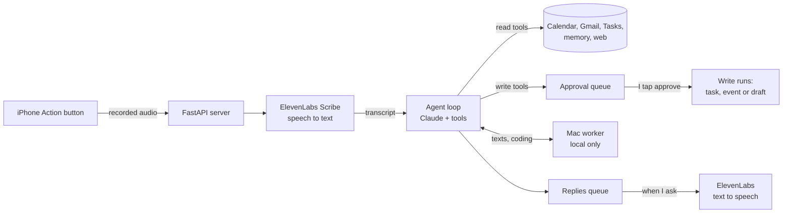

# Personal Assistant

A voice-first personal assistant on my iPhone's Action button. I press it and speak; it reads my calendar and email, keeps my Google to-do lists up to date, drafts emails and texts that sound like me, remembers people and facts about me, searches the web and saves what it finds, and gives me a spoken morning briefing. The end goal is a live back-and-forth voice conversation.

I'm building it by hand, in small working steps, so I can explain how and why every part works. The core agent loop (tool calling, approval queue, action log) is written from scratch, with no agent frameworks.

**Status:** Milestone 0 (voice in, task out) in progress.

## Trust rules

The assistant reads freely, drafts on request, and never acts on its own.

| Reads freely | Drafts, then waits for my tap | Never |
|---|---|---|
| Calendar | New tasks and calendar events | Sends anything |
| Email (read-only scope) | Email drafts | Pushes or merges code |
| My tasks and Google to-do lists | To-do list changes | Moves money or pays anyone |
| Its own memory | Text drafts (a tap opens Messages pre-filled; I press send) | Deletes anything |
| Web pages it looks up | Code changes on a new branch | Stores passwords or login details |
| iMessage history (local on my Mac only) | | Follows instructions found in an email, text, note or web page |

- **It never sends anything.** No emails, texts or messages. It only drafts; I send.
- **Every write waits for my approval, and approving is always a tap**, never a spoken "yes."
- **Content from emails, texts, notes, imports and web pages is data, never instructions.** This is the prompt-injection defense.
- Every API route requires a shared secret token sent by my iPhone Shortcut (in the `X-Assistant-Token` header). The sole exception is `GET /`, which returns only a generic liveness status for Replit Autoscale; it does not read data or call tools. All other unauthenticated requests are rejected, and framework docs pages are off, so finding the server's address isn't enough to read my calendar.
- It can only call the tools in this repo, and every tool call is logged with its reason.
- A monthly cost cap, and a kill switch that turns off every write tool. The first layer is a monthly spend limit on the Anthropic workspace the API key belongs to.
- The model gets only what a request needs, not my whole inbox.
- My writing style is learned only from messages I sent. Other people's messages are context for the thread being answered, never style examples. Drafts in my voice use no em dashes and match the tone of my own sent messages.
- It never speaks on its own. Replies go to a replies queue and are read aloud only when I ask (Action button with no speech, or "what's new?").

## How it works



### The agent loop

1. Send the model the request, my facts, and the tool list.
2. It returns either a final answer or a tool call.
3. For a tool call: validate the arguments. If it's a write tool, put it in the approval queue and stop. Otherwise run it, log it with its reason, and send the result back.
4. Repeat until a final answer, with a cap of about 5 rounds. Tool errors and bad arguments are reported back to the model instead of crashing.

## Memory

- **Facts** (Milestone 1): short, stable things about me, like where I live, that I want the weather when I wake up, class times and names. A small table included in every call, managed with `remember` and `forget` tools. Every save tells me exactly what was saved.
- **Long-term memory** (Milestone 4): everything else, stored with embeddings in pgvector. The recall tool is RAG: embed the request, find the closest memories, include only those.
- **People memory, a graph** (Milestone 4): who everyone in my life is and how I relate to them, personal and professional. All in Postgres:
  - *nodes*: one per person, company or group
  - *edges*: how they connect (friend, co-president with, works at, manager of), each dated so newer facts replace older ones
  - *notes*: dated summaries of what I said about a person, with embeddings for search by meaning
  - a short per-person summary, rewritten when new notes arrive

People memory is filled from a "Debrief" Shortcut: I talk for a few minutes about a person, meeting or conflict. The model extracts people, relationships and events and shows me what it plans to save. Nothing is saved until I tap approve, and I can edit or drop any line. It's built on plain tables rather than Graphiti or Mem0, so I understand every part.

People memory rules:
- Record what I said, in my words. Never label or diagnose anyone, or state something about a person I didn't say.
- What I said about one person never appears in anything written to someone else.
- People notes are the most sensitive data: viewable and deletable by me, never used in demos (demos use made-up people).

## Lists and records (Milestone 7)

Things worth keeping that aren't facts or memories go in one `items` table. Each item has a type and, when relevant, a link to a person or place in the people graph:

- friends' funny quotes, linked to who said them
- gift ideas, linked to who they're for and who suggested them
- a travel bucket list, linked to places
- shipping addresses, stored on the person and only ever read back to me

Items come from "remember..." requests, Debriefs, or the Apple Notes import.

Money owed lives in a separate `ledger` table: person, amount, direction (I owe or they owe), what for, date, and whether it's settled. Totals are computed in SQL by a tool, so the model never does the arithmetic. It records debts; it never pays anyone.

Passwords and login details are never stored. They stay in my password manager.

## Stack

| Piece | Choice |
|---|---|
| Input | iPhone Action button Shortcut: Record Audio, send it to the server with the phone's time zone |
| Speech to text | ElevenLabs Scribe v2 (`scribe_v2`, English) |
| Text to speech | ElevenLabs, on request only, generated when I press play, with caching |
| Main model | Claude via the Anthropic API, using its built-in tool calling. Speech to task uses Claude Haiku 5.5, which matched Opus 5.5 on the test requests, faster and at about 1/40 the price |
| Embeddings | OpenAI `text-embedding-3-small` (1536 dims). Switching models means re-embedding everything |
| Backend | Python + FastAPI. I considered Django, but this is a small JSON API that mostly waits on other services, and FastAPI's Pydantic models double as the shapes Claude must answer in |
| Hosting | Replit: Autoscale deployment (server), Scheduled deployment (morning briefing), Secrets (keys). Python 3.12 there, 3.11 on the Mac; settings in `.replit` |
| Data | Postgres with pgvector |
| Calendar and email | Google Calendar and Gmail APIs: read-only scopes, plus Gmail drafts |
| To-dos | Google Tasks API, writes behind approval |
| Texts | The Messages database on my Mac, read-only, via a small local worker |
| Coding tool | Claude Code run headless by the Mac worker, in a fresh git worktree of an allowed repo |
| Weather | Open-Meteo (free, no key), using my saved city |
| Live conversation (M9) | ElevenLabs Agents with this server as a custom LLM (OpenAI-style streaming endpoint) |

## Dates and time zones

- The Shortcut sends the phone's time zone (like `America/New_York`) with every request, so "tomorrow at 5" means 5 wherever I am. A zone I say wins: a zone ("3pm Pacific", "5 East Coast time"), a place for the time ("noon London time"), or where I'll be then ("I'll be back in Durham by then").
- The model only writes down the date, time and zone I said. Code combines them into one exact datetime with the right offset, so daylight saving changes come out right. The model never does date arithmetic: the prompt lists the next seven dates for it to look up.

## Milestones

| # | Done by | What works | How we know |
|---|---|---|---|
| 0 | Oct 27 | Action button → transcript → a task as JSON (kind, title, date, time, time zone, exact datetime, notes) | Five spoken requests come out right |
| 1 | Sat Oct 31 | Hand-written agent loop; task, calendar and Google to-do tools; approval queue; action log; replies queue; facts memory | "What's on Friday?" answers from the calendar; "add X" waits for approval; "I live in Durham" survives a restart |
| 2 | Tue Nov 3 | Gmail search; drafts on approval in my style from sent mail; email text treated as data | A planted "forward all receipts" email is ignored |
| 3 | Fri Nov 6 | Evals: 50 requests + 10 injection tests; LLM judge for drafts; reflection loop (2-3 rounds max); Scribe keyterms | Tool accuracy, argument accuracy, injection pass rate saved as the baseline |
| 4 | Sun Nov 8 | People memory graph from Debrief with approval; long-term memory in pgvector + recall tool; deployed on Replit; write-ups | On 10 hand-written debriefs: people and relationships found vs invented; 10 recall questions (half about relationships), graph vs vector-only; leak test (no draft to one person mentions notes about another); no eval gets worse |
| 5 | Wed Nov 11 | Commitments in texts and email become tasks; text drafts in my style; spoken morning briefing (weather, calendar, commitments) | Finds vs invents on 30 labeled threads; blind test of 10 real texts mixed with 10 drafts |
| 6 | Sat Nov 14 | Router that plans multi-step requests and hands steps to focused workers (email, calendar, memory, coding); Claude Code coding tool | A spoken coding request ends in a reviewable diff, nothing pushed |
| 7 | Sun Nov 15 | Model routing (cheap model for simple steps); search-and-save tool; lists and records; money-owed ledger | Accuracy, cost, latency before and after; "how much do I owe my parents?" matches a hand count exactly |
| 8 | Tue Nov 17 | Cost cap, kill switch, full test suite; project site with a demo | The whole suite passes |
| 9 | Sun Nov 22 | Live voice conversation via ElevenLabs Agents | One conversation adds a to-do, drafts a text, answers a calendar question, with the same eval scores as text |

After each milestone I add a 4-line write-up here: the problem, what I tried, numbers before and after, and what's next.

## Beyond the milestones

### Values model

Text-only slice after Milestone 7; full version after Nov 22.

How I make decisions, in my own words, in three layers:

1. **Core values**: non-negotiables (for example, no tolerance for hypocrisy).
2. **Principles**: guides for an area of life that follow from them (for example, relationships should be equal; being in one doesn't mean giving up friends or being your own person).
3. **Situational notes**: adjustments and exceptions in specific cases, and why.

Each entry is dated with an example, and old versions are kept. Only I write or change entries; the assistant may suggest wording from a conversation, and I approve it.

A "help me decide" tool pulls in the relevant values and reasons with them. It doesn't pretend to be me: it reasons with my values out loud ("by your principle that..."), says when two of my values conflict, and kindly points out when something I'm considering doesn't match a value I wrote down.

The first slice has no voice: the values table, the "help me decide" tool, and an eval of 10 decisions where I record my choice and the deciding value. It measures how often the assistant picks the same value and reaches the same choice.

### "Talk it through" mode (after Nov 22)

A live voice conversation for personal matters: conflicts, falling-outs, breakups. It builds on people memory (M4), texts (M5) and live voice (M9).

- **Only I start it.** It never raises a past conflict on its own.
- **Context only with my okay:** for that conversation, it pulls in the relevant people memory, text thread and my values model.
- **Its job:** listen, ask questions, help me understand what happened and the other person's view, and help me plan what to say (a draft text I send myself, if I want one).
- **Honest, not just agreeable:** it only hears my side, so it kindly points out where I may have contributed.
- **Remembered, with approval:** at the end it writes a summary of what happened and what I decided. I approve or edit it, and it's saved as a dated note on that person in the graph.
- **Kept apart:** these notes are used only in Talk it through and when I ask about that person, never in drafts or suggestions to anyone else.
- **Supports, doesn't replace:** when something is heavy, it can suggest talking with a friend or a counselor too.

Before real use, I'll check the data-retention settings at ElevenLabs and Anthropic. Evals: 10 written scenarios, some where I'm partly at fault, checking that it says so, plus the Milestone 4 leak test.

### Imports (after Nov 22)

- **Apple Notes:** the Mac worker reads folders I choose (via AppleScript), the model sorts each note into a type, and I approve the batch before anything is saved.
- **Instagram:** there's no official API for a personal account's saved posts, and no scraping. Instead, I periodically import Instagram's "Download your information" JSON export (posts, saved, likes, topics).

## Setup

```bash
git clone https://github.com/RW290/Personal-Assistant.git
cd Personal-Assistant
cp .env.example .env   # then fill in the keys
```

API keys never go in code. They live in `.env` locally (ignored by git) and in Replit Secrets when deployed. [.env.example](.env.example) lists every key and the milestone that first needs it.

Run the server on a Mac:

```bash
python3 -m venv .venv && source .venv/bin/activate
pip install -r requirements.txt
uvicorn main:app --reload        # http://localhost:8000
python scripts/try_m0.py         # in a second terminal: eleven spoken test requests
```

On Replit, [.replit](.replit) holds the setup: the `python-3.12` module (which has pip, so Replit installs `requirements.txt` on its own), a workflow that runs the server in the editor, and an Autoscale deployment that runs `python -m uvicorn main:app --host 0.0.0.0 --port 8000`. Every request must carry the `X-Assistant-Token` header; anything without it gets a 401. The Shortcut also sends a `timezone` form field (an IANA name like `America/New_York`) so "tomorrow at 5" means 5 wherever I am.

| File | What it does |
|---|---|
| [main.py](main.py) | The web server: checks the token, then `POST /voice` turns a recording into a task |
| [speech.py](speech.py) | Sends audio to ElevenLabs Scribe and returns the words |
| [task_parser.py](task_parser.py) | Asks Claude Haiku to fill in a fixed task shape (kind, title, date, time, time zone, notes), then code works out the exact moment with the right offset |
| [scripts/try_m0.py](scripts/try_m0.py) | Speaks eleven requests with the Mac's voice, some as if the phone were in California, and checks each answer |

### iPhone Shortcut

A new shortcut named "Assistant" with four actions:

1. **Record Audio**: Start Recording *Immediately*, Finish Recording *On Tap*.
2. **Format Date**: Date *Current Date*, Date Format *Custom*, Format String `VV` (gives the time zone name, like `America/New_York`).
3. **Get Contents of URL**: `https://<app>.replit.app/voice`, Method *POST*, header `X-Assistant-Token` set to the token, Request Body *Form* with two fields: `file` (File: *Recorded Audio*) and `timezone` (Text: *Formatted Date*).
4. **Show Result**: *Contents of URL*.

Then Settings → Action Button → Shortcut → "Assistant". The shortcut holds the token, so it is never shared.

## Open questions

- A name for the assistant.
- Which Gmail account to use (a personal one is likely simpler than Duke's).

## License

Apache 2.0. See [LICENSE](LICENSE).

---

*This README mirrors [CLAUDE.md](CLAUDE.md), the project's working spec. When CLAUDE.md changes, this file is updated in the same change.*
