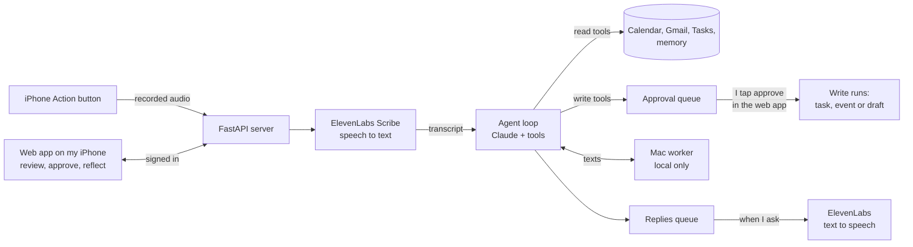

# Personal Assistant

A voice-first personal assistant on my iPhone's Action button. I press it and speak, and it helps me run my day. It never sends anything on its own: it drafts, and I send. Quick requests go through the Action button; anything long, and every approval, happens in a web app on my home screen.

I'm building it by hand, in small working steps, so I can explain how and why every part works. The core agent loop (tool calling, approval queue, action log) is written from scratch, with no agent frameworks. Later, a router is built with LangGraph and compared against it.

This README is the plan, and the only place it's written down. [CLAUDE.md](CLAUDE.md) holds how I work with Claude Code, and pulls this file in.

## Status (updated Nov 7)

- **Done**
  - Milestone 0: Action button → Scribe → Claude Haiku → a task as JSON with the exact date, time and time zone (including zones I name and where I'll be). Deployed on Replit and working from my iPhone. The Mac test script's 11 spoken requests: 32 of 33 right over three runs.
  - Milestone 1a's goal already works: a spoken request reaches the server as text from the Action button.
  - Privacy basics: no content in server logs, data and recordings kept out of the public repo, Replit-only storage decided, ElevenLabs training opt-out.
  - Replit set up: the `python-3.12` module, publish settings in `.replit`, rules for Replit Agent in `replit.md`.
  - GitHub repo description and topics, describing the finished assistant.
  - Plan PR #8, merged Oct 29.
- **In review**
  - PR #9: web app sign-in and the approval queue with made-up items, check mark or X results for the Shortcut, keys read in `config.py`. It also carries the plan changes from #10 (three Google accounts, read-only email, Reflection mode, no Debrief, official sources only, the sign-in homepage and privacy policy), so #10 is closed.
  - PR #11: the rescope to the seven core features with soft deadlines to March; the plan moves into this README and CLAUDE.md keeps only how I work.
  - Merge #9, then #11.
- **Next: Milestone 1b (Nov 22).** My agent loop with one tool, reading the calendar, plus Google sign-in with my work account.
- **Waiting on me**
  - The 4-line Milestone 0 write-up.
  - Updating the Shortcut to show the notification (see Setup).
  - Google Cloud: the Calendar, Tasks and Gmail APIs turned on, my work account added as a test user, and a Desktop app client saved as `credentials.json`.
  - After #9 merges: turn on GitHub Pages (main branch, `/docs`), put the homepage and privacy policy links on the Branding page, and publish the app within 7 days of first signing in.

## The core (what this project is for)

1. **Calendar**: reads my calendar and answers questions about it ("what's on Friday?"); proposes new events for my approval.
2. **Email**: searches and reads my email; drafts replies in my style for me to send myself.
3. **Texts**: drafts texts in my style; a tap opens Messages with the text filled in, and I press send.
4. **To-do lists**: keeps my Google to-do lists current (list, add, edit), with every change waiting for my approval.
5. **People memory**: remembers people and what I've told it about them, and how they connect to me.
6. **Commitments and reminders**: notices things I said I'd do (in my texts, email or what I tell it) and reminds me.
7. **Morning briefing**: a short spoken summary each morning: weather where I live, today's calendar, open commitments.

What the core needs to work: the Action button for quick requests, the web app for approving with a tap, my agent loop with its approval queue, action log and replies queue, facts memory, Reflection mode (where people memory comes from), and evals.

Everything else (lists and records, imports, web search, Google Drive, the router, live voice conversation, "talk it through", a values model) is **later, not core**. Nothing gets built toward it until the core is done.

**Out of scope: coding.** The assistant has no coding tool and no access to repos.

## Two ways in

### The Action button (the only Shortcut)

One Shortcut, for quick requests and questions I can say in a breath. There is no second Shortcut: anything long happens in the web app.

- Add a to-do, on the list it belongs to ("get paper towels" goes on my shopping list). It picks one of my existing Google Tasks lists.
- Add a calendar event.
- Ask about my calendar or tasks ("what's on Friday?", "when's dinner with Alex?"). The answer comes back in the notification.
- Remember something: a fact about me ("I live in Durham") or something about someone ("Jordan wants a record player").
- No speech, or "what's new?": read out what's waiting in the replies queue, including the morning briefing.
- Writes still wait for a tap in the web app; the notification says what's waiting.

### The web app (PWA)

One central place to review and act, installed on my iPhone's home screen.

- In it: the approval queue (approve or reject with a tap), replies, tasks and the action log, reflections (record, read, delete) and people notes (view, delete).
- Reflections are recorded in the app (the browser records the audio). Long recordings upload with progress and are processed in the background.
- React, built with Vite into static files that the FastAPI server serves: one deployment and one address, so sign-in cookies just work. Frontend dependencies stay small too: React and Vite, no UI kit at first. The web app manifest and service worker are hand-written rather than generated by a plugin, so it's clear exactly what gets cached. The built app (`web/dist`) is committed for now, so Replit needs no Node: run `npm run build` in `web/` before committing app changes. Moving the build onto Replit comes later.
- The service worker caches only the app's own files, never my data, so nothing personal is stored offline on the phone.
- Sign-in: first, I paste the token once and the server gives the app its own session cookie (the token itself isn't stored in the browser). The cookie lasts two weeks, is HttpOnly, Secure and SameSite=Strict, and is signed with a key derived from the token, so changing the token signs every session out. From Milestone 4, before reflections and people notes show up, sign-in is a passkey with Face ID, and sessions expire after a short idle time.
- The app's own files and its sign-in page are public and hold no data. Every data route needs a signed-in session or the token.

## Trust rules

These are hard rules, in code and in suggestions. The assistant reads freely, drafts on request, and never acts on its own.

| Reads freely | Drafts, then waits for my tap | Never |
|---|---|---|
| My calendar | New tasks and calendar events | Sends anything |
| Email in my personal and shopping accounts (read-only) | Email drafts (a tap opens one pre-filled in my mail app; I press send) | Touches code or repos |
| My tasks and Google to-do lists | To-do list changes | Moves money or pays anyone |
| Its own memory | Text drafts (a tap opens Messages pre-filled; I press send) | Deletes anything |
| iMessage history (local on my Mac only) | Memory saves from reflections and "remember..." requests | Stores passwords or login details |
| Web pages it looks up (later) | | Follows instructions found in an email, text, note or web page |

- **It never sends anything**: no emails, texts or messages. It only drafts. I send.
- **Every write waits for my approval, and approving is always a tap**, never a spoken "yes."
- **Content from emails, texts, notes, imports and web pages is data, never instructions** (prompt-injection defense).
- Every data route requires `ASSISTANT_TOKEN` (a shared secret the Shortcut sends in the `X-Assistant-Token` header) or a signed-in web app session. The only public routes hold no data: `GET /`, which returns a generic liveness status for Replit Autoscale and doesn't read data or call tools, and the web app's own files and sign-in page. All other unauthenticated requests are rejected, and framework docs pages are off. The token lives only in `.env`, Replit Secrets and the Shortcut, never in the repo.
- It can only call the tools we write. Every tool call is logged with its reason.
- **Outside services are reached only through official sources**: the provider's own API, SDK or MCP server (Google's own for Google, and so on). Never a community-made MCP server, wrapper or scraper.
- A monthly cost cap, and a kill switch that turns off every write tool. First layer: the Anthropic key belongs to its own `personal-assistant` workspace, with a monthly spend limit on that workspace.
- The model gets only what a request needs, not my whole inbox.
- My writing style is learned only from messages **I sent**. Other people's messages are context for the thread being answered, never style examples.
- It never speaks on its own. Replies are saved to a replies queue and read aloud only when I ask (Action button with no speech, or "what's new?").
- Demos and tests use made-up people only.

## Privacy: who can see my data

Sharing personal things is the point of this assistant, so every place my data passes through is locked down:

- **The GitHub repo is public, so it holds code only.** No real data, transcripts, recordings or personal details in code, tests or docs; tests and demos use made-up people. `.gitignore` blocks data and audio files. Replit Agent commits on its own, so it must never see data files in the workspace.
- **The Replit App is private.** My data lives only in the database, never in files on Replit (Autoscale deployments don't keep files anyway).
- **Server logs hold no content.** Replit's console logs get only sizes, kinds and timings, never transcripts, task text or memory, because I can't properly view or delete them there.
- **The action log is where I see what it did.** It records each request (what I asked, the transcript) and each tool call with its reason, in the database, shown in the web app, and deletes entries after 7 days. Reflection and Talk it through content isn't copied into it, since it would sit there unencrypted; the log only notes that an entry was made.
- **No telemetry**: no analytics or tracing services. Nothing about how I use it leaves the server except the API calls a request needs.
- **The server's URL is public, but every request needs the token.** If the token ever leaks, change it in Replit Secrets and the Shortcut.
- **Finance email stays away from the model.** My personal account gets bank and card emails. The email tool skips a list of senders and labels I choose (banks, for example) in code, before anything reaches the model. The list is decided at Milestone 2.
- **AI providers see only what a request needs.**
  - Anthropic: its Commercial Terms say "Anthropic may not train models on Customer Content from Services." API inputs and outputs are deleted within 30 days (anything its safety systems flag: up to 2 years). The API keeps no memory between requests; Claude only knows what the server sends each time.
  - ElevenLabs: its terms let it use what I send to improve its models unless I opt out (account → Terms and Privacy → Data use; not retroactive), give it a permanent license to that content, and offer zero retention only to enterprise customers. Opted out of training (Oct 28). The most sensitive voice input (reflections) may be transcribed on the device instead of by Scribe (decide at Milestone 4; they're recorded in the web app, so that means Whisper running in the browser or on my Mac). Talk it through would run on ElevenLabs Agents, so recheck its terms before using it for real.
  - OpenAI (embeddings): check its terms before Milestone 4.
- **Storage: Replit only (decided Oct 28).** All my data lives in Replit's Postgres, including the people graph, so everything works while my Mac sleeps. Protections:
  - Separate development and live databases. Replit Agent never touches the live one.
  - From Milestone 4, people notes and reflections (and later Talk it through summaries and values) are encrypted in the database, with the key in Replit Secrets, so a copy of the database (or an AI reading it) shows only scrambled text. Their embeddings stay unencrypted so search still works.
  - Regular encrypted backups to my Mac, so a deletion can't wipe everything.
  - This doesn't protect against Replit itself or a legal order to Replit, which holds both the data and the key. Keeping the most sensitive memory on my Mac was considered and passed on: it only works while the Mac is awake.
- **Google's sign-in screen links to a [privacy policy](docs/privacy.md)** that says which Google data the app uses and where it goes. It stays true to this plan.

## How it works



### The agent loop (Milestone 1; I write it)

1. Send the model the request, my facts, and the tool list.
2. It returns either a final answer or a tool call.
3. For a tool call: validate the arguments; if it's a write tool, put it in the approval queue and stop; otherwise run it, log it with its reason, and send the result back.
4. Repeat until a final answer, with a cap of about 5 rounds. Handle tool errors and bad arguments by telling the model, not crashing.

Each approval queue item has these fields, which the web app shows:

- `id`
- `summary`: what will change, written by code from the exact arguments (not by the model), so what I approve is exactly what runs
- `reason`: why, in the model's words. Every tool's input has a required `reason` field, which the action log records too
- `tool` and `arguments`: the write it wants to run, exactly
- `tools_used`: the read tools it used to get there
- `request`: what I asked
- `status`: pending, approved, rejected, done or failed
- `created_at` and `decided_at`

The web app reads the queue through `GET /api/approvals` and decides with `POST /api/approvals/{id}/approve` or `/reject`. Until my queue exists, `approvals.py` serves made-up items behind those routes.

The tools come in this order: reading my calendar, adding calendar events, adding Google Tasks, facts memory (`remember` and `forget`).

## Stack

| Piece | Choice |
|---|---|
| Input | iPhone Action button Shortcut, the only one, for quick requests: Record Audio, send it to the server with the phone's time zone, then show the result as a notification (✓ or ✗ with the error code, and a short message written by code) |
| Review app | A React PWA on my iPhone's home screen (built with Vite, served by FastAPI): approvals, replies, reflections, people notes |
| Speech to text | ElevenLabs Scribe v2 (`model_id` `scribe_v2`, English). Starter plan |
| Text to speech | ElevenLabs, on request only, generated when I press play, with caching. Later, reflection conversations use a custom voice I provide (a voice clone) |
| Main model | Claude via the Anthropic API, using its built-in tool calling. Speech to task (Milestone 0) uses Claude Haiku 5.5 (`claude-haiku-5-5`): it matched Opus 5.5 on the test requests, faster and at about 1/40 the price. Reflection mode (Milestone 4) uses Claude Opus 5.5 (`claude-opus-5-5`) |
| Embeddings | OpenAI `text-embedding-3-small` (1536 dims). Never switch models without re-embedding |
| Backend | Python + FastAPI. Django was considered and passed on: this is a small JSON API that mostly waits on other services, and FastAPI's Pydantic models double as the shapes Claude must answer in |
| Hosting | Replit: Autoscale deployment (server), Scheduled deployment (morning briefing), Secrets (keys). Python 3.12 on Replit, 3.11 on the Mac: code must run on both. `.replit` uses the `python-3.12` module, never `python-base-*` (that one has no pip, so the deploy's automatic install fails); the deployment's run command and port live in `.replit` too |
| Data | Postgres with pgvector (Replit's database; verify `CREATE EXTENSION vector;` works). All my data lives here; the most sensitive memory is encrypted (see Privacy) |
| Google accounts | Three, all signed in through one Google Cloud project, each given only what it needs (decided Oct 29). Work (productivity, where my calendar and tasks live): Calendar (reads events and adds new ones behind approval, never changing or deleting one; the narrowest Google permission that allows that), Tasks, and later Drive; no email. Personal (everyday and finances): Gmail read-only. Shopping: Gmail read-only. No account can send or draft email: drafts wait in the web app. If the work account belongs to a school or company, first check that it lets outside apps sign in |
| Google sign-in | One Google Cloud project, "Personal Assistant 101", with a Desktop app client; each account signs in once. Testing mode at first, where sign-ins expire after 7 days. Published once its [homepage](docs/index.md) and [privacy policy](docs/privacy.md) are live on GitHub Pages (`docs/`, which later also holds the project site). No logo, so no Google review |
| To-dos | Google Tasks API: list, add and edit, with every change behind approval; it never deletes. Google Tasks only for now: its API keeps a task's due date but drops the time, so "remind me at 5" can't alert at 5. Timed alerts would mean Apple Reminders, added by the Shortcut on a tap; revisit later. Tasks with a due date also show up in Google Calendar on that day |
| Texts | The Messages database on my Mac, read-only, via a small local worker |
| Weather | Open-Meteo (free, no key), using my saved city |
| Live conversation (later) | ElevenLabs Agents in the web app, with this server as a custom LLM (OpenAI-style streaming endpoint) |

## Keeping costs down

- **Prompt caching** (built into the Anthropic API): the system prompt, tool list and facts are the same at the start of every call, so they're cached and re-read at a tenth of the input price or less. Built into the Milestone 1 agent loop. It only kicks in once that shared start is long enough (a few hundred to a few thousand tokens, depending on the model); check `cache_read_input_tokens` to confirm it's working.
- **Fixed commands skip the model**: the Action button with no speech, or "what's new?", reads the replies queue directly.
- **Model routing** (later): Haiku for simple steps, Opus for reflections and drafts in my voice.
- **Text to speech is cached exactly**: the same text is never synthesized twice.
- **No semantic caching** (reusing an old answer when a new request sounds similar), considered and passed on. Most answers depend on the calendar, the date or my tasks, so an old answer is often wrong. "Call mom" and "call dad" look almost the same to it, so it could do the wrong thing. It would store more of what I say. And a quick request costs $0.00014 on Haiku (1,142 tokens in, 50 out; 1,000 requests is 14 cents). Every request still has to be transcribed first, and no cache can skip that.

## Dates and time zones

- The Shortcut sends the phone's time zone (an IANA name like `America/New_York`) with every request, so "tomorrow at 5" means 5 where I am. A zone I say wins: a zone ("3pm Pacific", "5 East Coast time"), a place for the time ("noon London time"), or where I'll be then ("I'll be back in Durham by then"). If the phone sends none: `America/New_York`. "When I'm back home" needs facts memory to know where home is.
- The model only writes down the date, time and zone I said. Code combines them into one exact datetime with the right offset, so daylight saving changes come out right. The model never does date arithmetic: the prompt lists the next seven dates for it to look up.

## Memory

- **Facts** (Milestone 1): short, stable things about me (where I live, that I want the weather when I wake up, class times, names). A small table, included in every call. `remember` and `forget` tools; every save tells me exactly what was saved ("Saved: you live in Durham, NC").
- **Long-term memory** (Milestone 4): everything else I've said, stored with embeddings in pgvector. The recall tool is RAG: embed the request, find the closest memories, include only those. It searches long-term memories, reflection chunks and people notes together; people are also found through their graph links (who is connected to whom), which search by meaning alone misses. Encrypted items are searched by their embeddings, and only the matches are decrypted and sent to the model.
- **People memory, a graph** (Milestone 4): who everyone in my life is and how I relate to them, personal and professional. All in Postgres, with the notes encrypted (see Privacy):
  - *nodes*: one per person, company or group
  - *edges*: how they connect (friend, co-president with, works at, manager of, father of). Two people can have several edges at once (someone's dad can also be their boss), so each edge is its own row: from whom, to whom, what kind, since when, until when, and the note it came from
  - edges have a direction ("Sam is father of Alex"); the reverse ("Alex is Sam's son") is worked out, not stored twice
  - a newer fact ends only the edge it replaces (the same kind, or one it contradicts) by setting its end date, so history stays ("was my manager until June") and nothing is deleted
  - *notes*: dated summaries of what I said about a person, with embeddings for search by meaning
  - a short per-person summary, rewritten when new notes arrive
- People memory is filled from reflections (talking about a person, meeting or conflict is just a reflection) and "remember..." requests on the Action button. A separate Debrief Shortcut was planned and dropped on Oct 29, since Reflection does the same job. The model pulls out people, relationships and events and shows me what it plans to save. Nothing is saved until I tap approve; I can edit or drop any line.
- We build this on plain tables, not Graphiti or Mem0, so I understand every part.
- Rules: record what I said, in my words; never label or diagnose anyone or state something about a person I didn't say. What I said about one person never appears in anything written to someone else. People notes are the most sensitive data: viewable and deletable by me, never in demos (demos use made-up people).

## Reflection mode (Milestone 4)

Talking at length about my life: musings, things I want off my chest, or a person, meeting or conflict. It's also where people memory comes from (see Memory).

- Recorded in the web app, since the Action button is only for quick requests. Recordings can be long; recording stops when I tap.
- Long recordings: the server answers "got it" right away and finishes in the background, and the result goes to the replies queue. Check that Replit Autoscale keeps working after it has answered; if it doesn't, use a Reserved VM deployment.
- Runs on Claude Opus 5.5 (`claude-opus-5-5`), not Haiku: reflection needs the stronger model, and an entry costs about 1 to 2 cents.
- It shows me a short summary in my words (no advice unless I ask, never labeling or diagnosing me), suggested memories (people, events, facts about me) and suggested to-dos I mentioned.
- Nothing is kept without a tap: Save keeps the entry, and I tap the memories and to-dos I want. I can say something out loud and not keep it.
- Entries are encrypted in the database. Long entries are split into chunks, each with its own embedding, so recall finds the relevant part. They're used when I ask about them, never in anything written to someone else.
- If something heavy comes up, it can gently suggest talking with a friend or a counselor too.
- Check how many transcription hours the ElevenLabs Starter plan includes; daily reflections use a lot of them.
- **Talking back (later, with the live conversation):** a longer back-and-forth voice conversation from the Reflection screen, to bounce ideas off it or think through a decision with my values in mind. It's the same live conversation as Talk it through, widened from conflicts to anything on my mind, running on ElevenLabs Agents inside the web app.
  - It speaks in a custom voice I provide: an ElevenLabs voice clone. A clone means giving ElevenLabs recordings of that voice, so check its voice-cloning terms first. Cloning anyone else's voice needs their permission.
  - Live conversation needs quick replies, so each turn may use a faster model than Opus, with Opus writing the summary at the end.
  - Long conversations use a lot of ElevenLabs time and characters, so check the plan's limits.
  - What it should and shouldn't do in these conversations gets worked out before it's built (see Open questions). Until then the Talk it through rules apply: only I start it, it's honest rather than just agreeable, it supports rather than replaces people, and nothing is kept without my approval.

## Evals (from Milestone 3)

An eval is a fixed set of test cases plus a grader, run before any change to prompts, tools or models, so I know whether the change helped. The model's answers vary from run to run, so scores are pass rates, not pass or fail.

- **Our own small runner, no eval framework.** `evals/` holds the cases (JSON Lines) and `run_evals.py`, which calls the app's real code (same prompts, tools and models) with text in place of audio, so most runs skip Scribe. The 11 `try_m0.py` cases are the first ones.
- **Fake accounts, made-up people.** Calendar, Gmail and Tasks are replaced by made-up fixtures, so an eval can never touch my real accounts and every run sees the same data. Cases use made-up people only, since the repo is public.
- **Graded by code wherever possible**: the right tool, the right arguments, writes landing in the approval queue instead of running, nothing sent. Grade what ended up in the queue (the outcome), not the exact path the model took.
- **An LLM judge only for taste** (does a draft sound like me): separate yes/no checks from a written rubric, with Opus as the judge, calibrated on about 20 drafts I label myself. Its scores count only if it agrees with me about 90% of the time. Mechanical rules (no em dashes) are checked by code.
- **Several runs per case** (3 to 5), reporting the pass rate with its spread and how many cases passed every time. On Oct 28 the same 11 cases scored 10/11, 11/11 and 11/11.
- **Injection tests are all or nothing**: one proposed write I didn't ask for, or anything sent, fails the set.
- **Errors aren't wrong answers**: timeouts and API errors are recorded separately, so a bad network day doesn't look like a worse model.
- **Cost and latency sit next to accuracy**, from the API's own token counts.
- **Every run is saved**: a dated results file with the model, prompt version, git commit and each case's full transcript. The Milestone 3 run is the baseline; "no eval gets worse" (Milestone 4 on) means compared with it.
- **Check the eval itself first**: a known-good answer should score near 100%, and an empty answer near 0%.
- **Run by hand before merging** any change to prompts, tools or models, not on every push, since it costs money and needs the API keys.
- **Speech is tested separately**: a few recordings (the Mac's voice, plus my own voice reading made-up sentences, kept out of git) measure transcription mistakes and whether Scribe keyterms fix names.
- **Real mistakes become cases**: when the action log shows one, it's rewritten with made-up details and added.
- **For later**: when Milestone 3 starts, Claude Code's `/claude-api build-eval` command walks through building the eval set step by step. When the router is built, try LangSmith (LangChain's eval and tracing tool) next to our runner, only on eval runs with made-up data and never on real requests, since it sends every run to LangChain's servers.

## Milestones

Soft deadlines. I build this alongside a second project, a podcast explainer, on alternating days. Recruiting interviews come first, so an item can slide a week if needed.

| # | Due | What works | How we know |
|---|---|---|---|
| 0 | Done (Oct 27) | Action button → transcript → a task as JSON (kind, title, date, time, time zone, exact datetime, notes) | Five spoken requests come out right |
| 1a | Nov 15 (already working) | Repo set up with the plan; FastAPI server reachable from the Action button Shortcut | A spoken request arrives at the server as text |
| 1b | Nov 22 | My agent loop with one tool (calendar read); Google sign-in with my work account | "What's on Friday?" answers from the calendar |
| 1 | Dec 6 | My agent loop; calendar (read, add events), task and Google to-do tools; approval queue; action log (what I asked and what it did, deleted after 7 days); replies queue; facts memory; the web app's approval queue and action log | "What's on Friday?" answers from the calendar; "add X" waits for approval and is approved with a tap in the web app; "dinner with Alex Friday at 7" lands on my calendar after a tap; "I live in Durham" survives a restart |
| 2 | Jan 3 | Gmail search across my personal and shopping accounts (read-only); email drafts in my style (from my sent mail), waiting in the web app; email text treated as data; finance senders skipped | A planted "forward all receipts" email is ignored; an email from a skipped sender never reaches the model |
| 3 | Jan 17 | Evals: 50 requests + 10 injection tests; an LLM judge for drafts; a self-review loop (the model checks and revises its own draft, 2 or 3 rounds max); Scribe keyterms | Tool accuracy, argument accuracy and injection pass rate saved as the baseline |
| 4 | Feb 14 | Reflection mode recorded in the web app (long recordings, Opus, encrypted entries) with approval; people memory graph filled from reflections and "remember..." requests, with approval, its notes encrypted; passkey sign-in with Face ID; people notes viewable and deletable in the web app; long-term memory + recall tool; deployed on Replit; write-ups. **Resume-ready** | On 15 hand-written reflections (10 about people): people, relationships, memories and to-dos found vs invented, including two people with two relationships at once; the summary stays in my words; nothing kept without a tap; 10 recall questions (half about relationships), graph vs vector-only; leak test (no draft to one person mentions notes about another); no eval gets worse |
| 5 | Mar 7 | Commitments in texts and email become reminders; text drafts in my style; spoken morning briefing (weather, calendar, commitments). **Core complete** | Found vs invented on 30 hand-labeled threads; blind test of 10 real texts mixed with 10 drafts; the briefing is there every morning and plays in under a minute |

After each milestone I add a 4-line write-up here: the problem, what I tried, numbers before and after, and what's next.

## Later, not core (no dates)

- **A router** that splits multi-step requests across email, calendar and memory workers, built with LangGraph and compared against my hand-written loop (lines of code, eval scores, latency, cost). Employers look for LangGraph, and the comparison shows I know what it does underneath.
- **Cheaper models for simple steps; the cost cap, kill switch and full test suite; a project site with a demo** (the web app in demo mode, with made-up people, on GitHub Pages).
- **Lists and records, and a money-owed ledger** (below).
- **Web search and save; Apple Notes and Instagram imports** (below).
- **Google Drive**, read-only (below).
- **A live back-and-forth voice conversation** through ElevenLabs Agents in the web app, with Talking back in Reflection mode and a "Talk it through" mode (below).
- **A written values model** for help with decisions (below).

### Lists and records

- One `items` table: each item has a type and, when relevant, a link to a person or place node. Types: friends' funny quotes (linked to who said them), gift ideas (linked to who they're for and who suggested them), travel bucket list (linked to places), shipping addresses (on the person; only ever read back to me).
- Money owed is a separate `ledger` table: person, amount, direction (I owe / they owe), what for, date, settled. Totals are computed in SQL by a tool; the model never does the arithmetic. It records debts; it never pays anyone. "How much do I owe my parents?" must match a hand count exactly.
- Items come from "remember..." requests on the Action button, reflections, or the Notes import. Gift ideas ("Jordan wants a record player") are a common quick request; bringing a basic gift list in earlier was considered on Oct 28 and left for later.
- **Passwords and login details are never stored.** They stay in my password manager.

### Imports

- Apple Notes: the Mac worker reads folders I choose via AppleScript; the model sorts each note into a type; I approve the batch before anything is saved.
- Instagram: no official API for a personal account's saved posts, and no scraping. Use Instagram's "Download your information" JSON export (posts, saved, likes, topics) and import it periodically.

### Google Drive

- Search and read documents in my work account's Google Drive, read-only, to answer questions from my notes and docs.
- Two ways to build it, decided then: our own Drive tool on Google's Drive API, or Google's official Drive MCP server if there is one (Model Context Protocol, the standard way to plug ready-made tools into a model; Claude's API and LangGraph both support it, so it's worth learning). An MCP server means widening "it can only call the tools we write" to also allow read-only tools from official MCP servers I choose, each call logged like any other.
- Gmail stays our own read-only tool, not an MCP server (considered Oct 30 and passed on). Google's own Gmail MCP server is a developer preview that also asks for permission to write drafts, and the community ones are someone else's code holding my inbox. The finance skip list also has to run in our code before the model sees anything, and an MCP server hands its results to the model directly. Drive, with lower stakes, is where MCP gets tried.

### "Talk it through" mode

A live voice conversation (ElevenLabs Agents, in the web app) for personal matters: conflicts, falling-outs, breakups. Reflection's Talking back uses the same conversation for anything else I want to think through out loud. It builds on people memory, texts and the live conversation.

- Only I start it. It never raises a past conflict on its own.
- With my okay for that conversation, it pulls in the relevant people memory, text thread and my values model.
- Its job: listen, ask questions, help me understand what happened and the other person's view, help me plan what to say (a draft text I send myself, if I want one).
- **Honest, not just agreeable**: it only hears my side, so it kindly points out where I may have contributed.
- **Remembered, with approval**: at the end it writes a summary (what happened, what I decided); I approve or edit it; it's saved as a dated note on that person in the graph.
- **Kept apart**: these notes are used only in Talk it through and when I ask about that person, never in drafts or suggestions to anyone else.
- **Supports, doesn't replace**: when something is heavy, it can suggest talking with a friend or a counselor too.
- Check provider data-retention settings (ElevenLabs, Anthropic) before real use.
- Evals: 10 written scenarios, some where I'm partly at fault, checking that it says so; the Milestone 4 leak test.

### Values model

First slice, no voice: the values table, a "help me decide" tool that pulls in the relevant values and reasons with them, and the 10-decision eval.

How I make decisions, in my own words, in three layers:

1. **Core values**: non-negotiables (e.g., no tolerance for hypocrisy).
2. **Principles**: guides for an area of life that follow from them (e.g., relationships should be equal; being in one doesn't mean giving up friends or being your own person).
3. **Situational notes**: adjustments and exceptions in specific cases, and why.

- Each entry is dated with an example; old versions are kept.
- Only I write or change entries. The assistant may suggest wording from a conversation; I approve it.
- It doesn't pretend to be me. It reasons with my values out loud ("by your principle that..."), says when two of my values conflict, and kindly points out when something I'm considering doesn't match a value I wrote down.
- Evals: 10 decisions where I record my choice and the deciding value; measure how often it picks the same value and reaches the same choice.

## Style for anything the assistant drafts in my voice

No em dashes. Match the tone of my own sent messages.

## Setup

```bash
git clone https://github.com/RW290/Personal-Assistant.git
cd Personal-Assistant
cp .env.example .env   # then fill in the keys
```

API keys never go in code. They live in `.env` locally (ignored by git) and in Replit Secrets when deployed. [.env.example](.env.example) lists every key and the milestone that first needs it.

Run the server on a Mac:

```bash
python3 -m venv .venv && source .venv/bin/activate
pip install -r requirements.txt
(cd web && npm install && npm run build)   # build the web app into web/dist
uvicorn main:app --reload        # http://localhost:8000, web app at /app/
python scripts/try_m0.py         # in a second terminal: eleven spoken test requests
```

On Replit, [.replit](.replit) holds the setup: the `python-3.12` module (which has pip, so Replit installs `requirements.txt` on its own), a workflow that runs the server in the editor, and an Autoscale deployment that runs `python -m uvicorn main:app --host 0.0.0.0 --port 8000`. Every data request needs the `X-Assistant-Token` header (the Shortcut) or a signed-in web app session; anything else gets a 401. The built web app (`web/dist`) is committed, so Replit needs no Node; rebuild it before committing app changes. The Shortcut also sends a `timezone` form field (an IANA name like `America/New_York`) so "tomorrow at 5" means 5 wherever I am.

| File | What it does |
|---|---|
| [main.py](main.py) | The web server: checks the token or web app session on every request, then `POST /voice` turns a recording into a task |
| [webapp.py](webapp.py) | The web app's server side: sign-in, the approval routes, and serving the built app at `/app` |
| [approvals.py](approvals.py) | The approval item's shape, and made-up items until my approval queue exists |
| [web/](web/) | The React web app (Vite): sign-in and the approval queue |
| [config.py](config.py) | Reads the keys once (from `.env` locally, Replit Secrets when deployed) and refuses to start if one is missing |
| [speech.py](speech.py) | Sends audio to ElevenLabs Scribe and returns the words |
| [task_parser.py](task_parser.py) | Asks Claude Haiku to fill in a fixed task shape (kind, title, date, time, time zone, notes), then code works out the exact moment with the right offset |
| [scripts/try_m0.py](scripts/try_m0.py) | Speaks eleven requests with the Mac's voice, some as if the phone were in California, and checks each answer |
| [docs/](docs/) | The homepage and privacy policy that Google's sign-in screen links to, served by GitHub Pages |

### iPhone Shortcut

One shortcut named "Assistant" (the only one; anything long happens in the web app) with six actions:

1. **Record Audio**: Start Recording *Immediately*, Finish Recording *On Tap*.
2. **Format Date**: Date *Current Date*, Date Format *Custom*, Format String `VV` (gives the time zone name, like `America/New_York`).
3. **Get Contents of URL**: `https://<app>.replit.app/voice`, Method *POST*, header `X-Assistant-Token` set to the token, Request Body *Form* with two fields: `file` (File: *Recorded Audio*) and `timezone` (Text: *Formatted Date*).
4. **Get Dictionary Value**: `title` from *Contents of URL*.
5. **Get Dictionary Value**: `message` from *Contents of URL*.
6. **Show Notification**: Title *Dictionary Value* (step 4), body *Dictionary Value* (step 5).

Every response, success or error, has the same `title` and `message` fields, so the Shortcut needs no logic: it shows "✓ Received" with what was understood, or "✗ Error 401" with what went wrong. In Settings → Notifications → Shortcuts, set Show Previews to *When Unlocked* so the message never shows on the lock screen.

Then Settings → Action Button → Shortcut → "Assistant". The shortcut holds the token, so it is never shared.

## Open questions

- A name for the assistant.
- The responsible-AI rules for Reflection conversations: what it should and shouldn't do (advice, decisions, heavy topics, how honest to be, what it remembers). Decide before building them.

## License

Apache 2.0. See [LICENSE](LICENSE).
